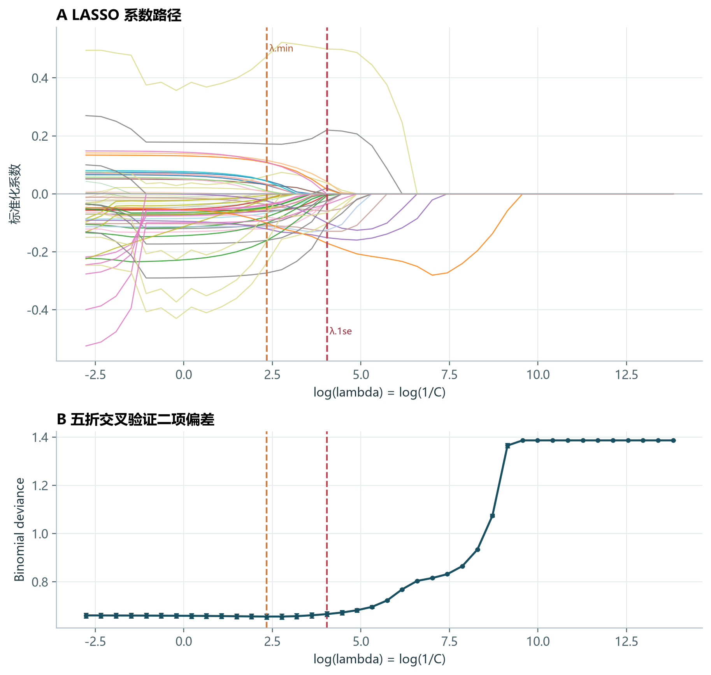
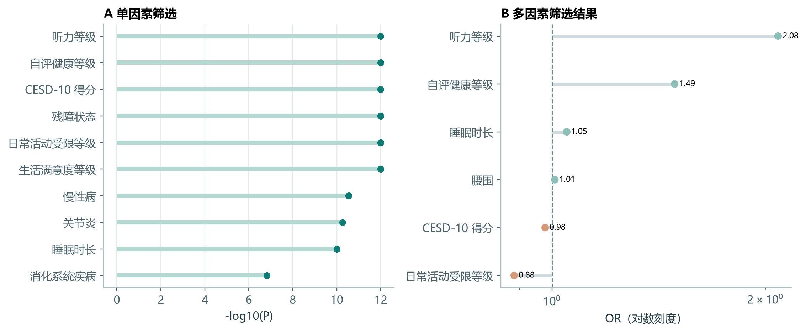
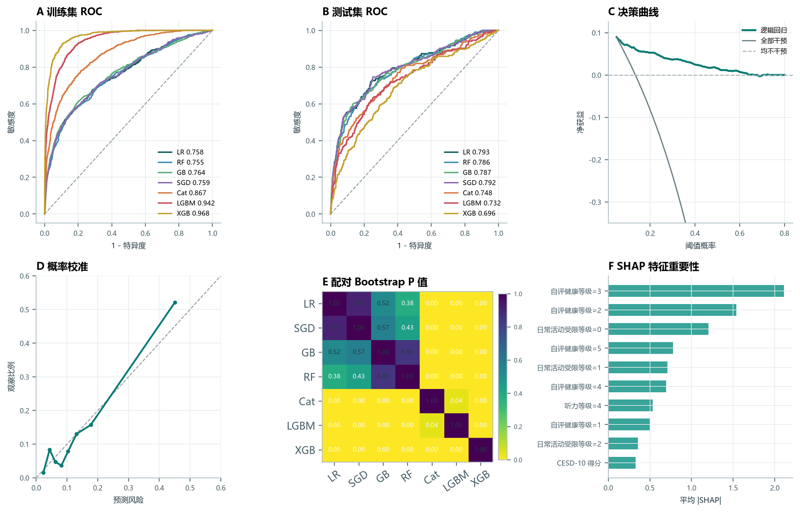
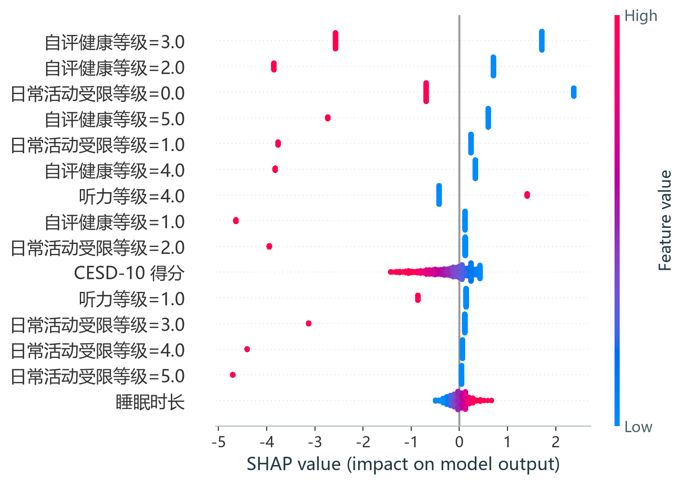
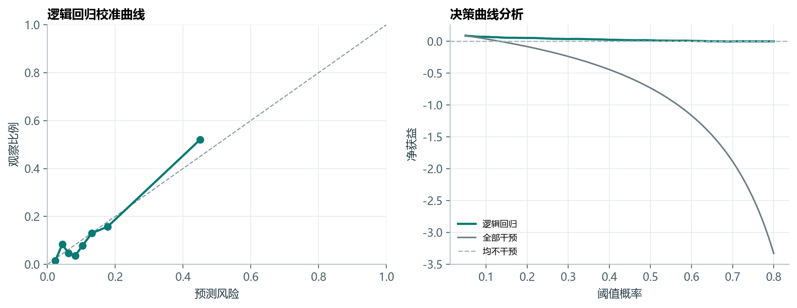

# 从变量筛选到可解释模型：一次中老年视力结局分析实践

这是一个以学习、复盘和可复核为目标的个人数据分析项目。项目从公开、脱敏的健康调查数据出发，完成结局定义、变量筛选、LASSO、类别不平衡处理、多模型比较、概率校准和 SHAP 解释。

本项目不用于临床诊断，也不提供个体医疗建议。

## 项目概览

| 项目 | 结果 |
|---|---:|
| 分析人群 | 65 岁及以上 |
| 分析样本 | 7,661 |
| 阳性结局 | 1,022（13.3%） |
| 训练/测试划分 | 8:2 |
| 连续变量 | 4 |
| 分类或等级变量 | 33 |
| 单因素筛选后 | 31 |
| LASSO λ.1se 后 | 16 个原始变量 |
| 单因素与 LASSO 交集 | 14 |
| 多因素筛选后 | 6 |
| 最佳模型 | 逻辑回归 |
| 测试集 AUC | 0.793 |
| Bootstrap 95% CI | 0.757-0.832 |
| 校准后 Brier 分数 | 0.091 |

阳性结局定义为 `eyesight_close == 4` 或 `eyesight_distance == 4`。`ID`、`householdID`、`communityID` 及两个结局字段均不进入预测变量，避免标识符干扰和结果泄漏。

## 分析流程

1. 按年龄和结局字段完整性筛选样本。
2. 将变量拆分为连续变量与分类/等级变量。
3. 使用分层 8:2 划分训练集和测试集。
4. 在训练集内完成连续变量中位数插补与分类变量众数插补。
5. 使用 Mann-Whitney U 检验和卡方检验进行单因素筛选。
6. 使用五折交叉验证的 L1-LASSO 完成稀疏变量选择。
7. 将单因素结果与 LASSO λ.1se 变量集取交集，再进行多因素逻辑回归逐步筛选。
8. 仅在训练集执行 SMOTENC，测试集保持原始类别分布。
9. 比较七类模型，并使用 AUC、准确率、精确率、召回率、F1、Brier、校准曲线与 DCA 评价。
10. 对逻辑回归进行 sigmoid 概率校准和 SHAP 解释。

## 1. LASSO 变量筛选

LASSO 路径按原始变量着色；同一变量的不同哑变量使用同一色系。正则化逐渐增强时，各变量系数最终收缩到零。交叉验证图中同时标记了 `lambda.min` 和更稀疏的 `lambda.1se`。

本次五折交叉验证结果：

- `lambda.min` 保留 31 个原始变量。
- `lambda.1se` 保留 16 个原始变量。
- 为控制模型复杂度，后续使用 `lambda.1se` 对应的变量集。

> 注：图中横轴按代码实现定义为 `log(lambda) = log(1/C)`。

## 2. P 值与多因素筛选

单因素结果用于缩减候选变量，随后与 LASSO 变量集取交集。单因素 P 值没有进行多重比较校正，因此只作为探索性筛选步骤。

最终进入多因素逻辑回归的变量为：

- 听力等级
- 自评健康等级
- 日常活动受限等级
- CESD-10 得分
- 腰围
- 睡眠时长

这些变量是当前数据集和编码体系下的统计关联，不代表已经验证的因果关系或临床危险因素。

## 3. 模型比较

SMOTENC 仅作用于 6,128 条训练样本，将训练集扩充到 10,622 条，阳性与阴性各 5,311 条。测试集保持原始分布，没有参与重采样。

| 模型 | 训练 AUC | 测试 AUC | 准确率 | 精确率 | 召回率 | F1 | Brier |
|---|---:|---:|---:|---:|---:|---:|---:|
| Logistic Regression | 0.758 | 0.793 | 0.881 | 0.672 | 0.220 | 0.331 | 0.091 |
| SGD Classifier | 0.759 | 0.792 | 0.862 | 0.487 | 0.546 | 0.515 | 0.128 |
| Gradient Boosting | 0.764 | 0.787 | 0.832 | 0.411 | 0.585 | 0.483 | 0.157 |
| Random Forest | 0.755 | 0.786 | 0.736 | 0.294 | 0.693 | 0.413 | 0.241 |
| CatBoost | 0.867 | 0.748 | 0.830 | 0.385 | 0.459 | 0.419 | 0.129 |
| LightGBM | 0.942 | 0.732 | 0.829 | 0.374 | 0.415 | 0.394 | 0.127 |
| XGBoost | 0.968 | 0.696 | 0.816 | 0.326 | 0.351 | 0.338 | 0.139 |

逻辑回归与 SGD 的测试集 AUC 最接近。逻辑回归在概率校准后取得更低的 Brier 分数，同时保留较清晰的变量方向，因此被选为后续解释模型。

图中的六部分分别为：

- 训练集 ROC
- 测试集 ROC
- 决策曲线分析
- 概率校准
- 模型间配对 Bootstrap 比较
- SHAP 特征重要性

## 4. SHAP 可解释性

SHAP 将逻辑回归的 log-odds 预测拆分为各输入特征的贡献。贡献最集中的输入主要涉及自评健康等级、日常活动受限等级、听力等级、CESD-10 得分、腰围和睡眠时长。

由于当前数据没有附带完整变量字典，本文不把单个 SHAP 方向直接解释为临床风险机制。尤其是多级分类变量，不同取值可能呈现相反方向的贡献。

## 5. 校准与决策曲线

逻辑回归在训练集内通过交叉验证进行 sigmoid 概率校准。校准后 Brier 分数为 0.091，优于未校准版本。

低中风险区间的预测概率与观察比例较接近，高风险区间仍有残余偏差。DCA 只在部分阈值范围内相对“不干预”策略有轻微净获益，因此不能把它理解为已经具备明确的临床应用价值。

## 6. 学习过程中修正的问题

### 把结局变量误放入特征

最初处理数据时，两个视力结局字段很容易被当作普通预测变量。后续通过显式排除 `eyesight_close`、`eyesight_distance` 和三个 ID 字段，避免了结果泄漏。

### 一次进入模型的变量过多

先用单因素检验、再用 LASSO 和逐步多因素回归，使最终模型从 37 个候选变量缩减到 6 个。这个过程比一次性把所有字段投入模型更容易解释，也更容易发现冗余。

### 对类别不平衡只做重采样不够

SMOTENC 能改善训练集的类别分布，但会改变预测概率的基准。因此又增加了独立测试集评估和 sigmoid 校准。

### 准确率并不能完整描述模型

阴性样本占多数时，高准确率可能掩盖较低召回率。最终报告同时保留了 AUC、召回率、F1、Brier、校准曲线和 DCA。

## 7. 局限性与结论

当前结果是方法练习，不是已经完成的临床预测研究：

- 没有独立外部队列验证。
- 变量编码和完整调查设计信息有限。
- 变量筛选与调参仍存在一定乐观偏倚。
- SMOTENC 改变训练集分布，概率不能直接视为真实人群风险。
- 默认 0.5 阈值不适合直接用于筛查。

这个项目最重要的收获不是追求最高 AUC，而是建立一条可复核的分析链：先确认结局，再排除泄漏字段，在训练集内完成预处理、筛选和重采样，用独立测试集评估，并同时检查区分度、校准和决策价值。

## 数据与隐私

请阅读 [DATA_AND_PRIVACY.md](DATA_AND_PRIVACY.md)。本仓库不包含原始数据、直接标识符、联系信息或本地路径。

## 结果文件

- [Model metrics](results/model-metrics.csv)
- [Project summary](results/project-summary.json)
- [LASSO summary](results/lasso-summary.json)

